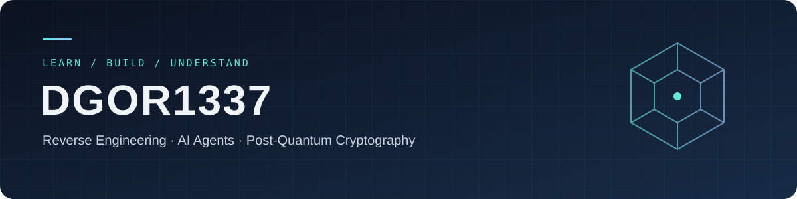

  

# Hi, I'm DGOR1337 👋

正在学习 **Unreal Engine 逆向工程**、**Harness 工程**与 **后量子密码（重点为格密码）**。

这里记录我的学习方向、实践探索，以及持续整理的工具与代码。

### 🔭 当前学习方向

| 方向 | 正在学习 |
| :--- | :--- |
| 🎮 **Unreal Engine 逆向工程** | Reverse Unreal Engine，理解引擎机制与程序行为。 |
| 🤖 **Harness 工程** | 学习如何为 AI Agent 设计工具接口、管理上下文，并通过评估验证其行为。 |
| 🔐 **后量子密码与格密码** | Post-Quantum Cryptography，以格密码为重点，逐步学习概念、算法与证明。 |

### 🧭 我的学习方式

- **理解原理**：把关键概念、成立条件和背后的机制弄清楚。
- **动手验证**：通过代码、实验与调试检查自己的理解。
- **持续整理**：将问题、推导和实践过程沉淀为学习笔记。

### 🛠️ 公开仓库

| 仓库 | 内容 |
| :--- | :--- |
| [CE_MCP](https://github.com/DGOR1337/CE_MCP) | 通过 MCP 连接 AI Agent 与 Cheat Engine，探索逆向分析工具的协作。 |
| [Fusion-IDA94](https://github.com/DGOR1337/Fusion-IDA94) | 面向 IDA Pro 9.4 / Windows x64 的 IDA-Fusion 社区兼容构建。 |

---

  <b>Reverse Engineering · AI Agents · Post-Quantum Cryptography</b> 
  学习、验证、记录，持续积累。

